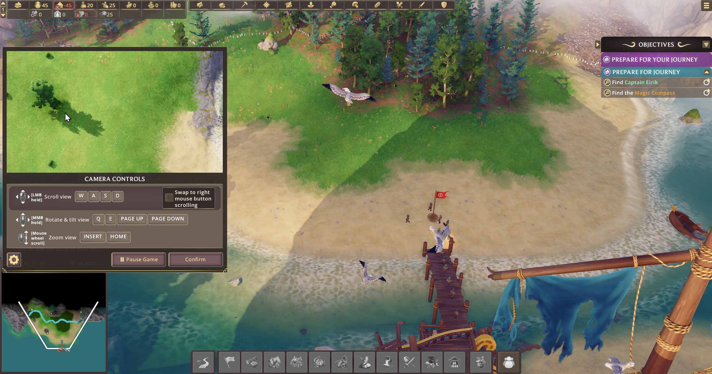

# Pioneers of Pagonia on Apple Silicon: terrain rendering through Madeira's D3D12 layer

Working notes from porting _Pioneers of Pagonia_ (Steam 2155180, D3D12 / DXIL, tessellated terrain)
to macOS by replacing Apple's D3DMetal with the open-source D3D12-on-Metal runtime from
[Madeira](https://github.com/willfaust/Madeira), running under a Porting Kit Wine wrapper.
Status: the game runs and plays with complete terrain at ~40 fps on an M2 Pro at 2560x1347.

Read in this order:

| Document                                                     | What it is                                                                                                                                                       |
| ------------------------------------------------------------ | ---------------------------------------------------------------------------------------------------------------------------------------------------------------- |
| [MADEIRA_PORT_PLAN.md](MADEIRA_PORT_PLAN.md)                 | The plan: why D3DMetal fails on the terrain (hull shader compile error), why Madeira might not, and the phased approach with go/no-go gates                      |
| [PHASE0_RESULT.md](PHASE0_RESULT.md)                         | Go/no-go: the game's hull/domain shaders run through Apple's Metal Shader Converter standalone                                                                   |
| [PHASE1_BUILD.md](PHASE1_BUILD.md)                           | Building Madeira's D3D12 layer and DXMT's winemetal for macOS x86_64 Wine; test results                                                                          |
| [PHASE2_LOG.md](PHASE2_LOG.md)                               | Running the game: every fix with its root cause (tessellator tables, BC1 reinterpreting copies, ...), diagnostics added to the runtime, and the performance work |
| [reproduce.md](reproduce.md), [reproduce2.md](reproduce2.md) | Step-by-step reproduction for a newcomer                                                                                                                         |

Supporting material: `phase0/` (carving and conversion scripts, converter results), `phase1/`
(test runner), `phase2/` (launch script, `madeira.cfg`, tools, and `patches/` with the full diff
against the Madeira and DXMT trees).

## Launching the game (everything built and patched)

With the wrapper copy at `~/Applications/Steambuild-Madeira.app`, the patched `d3d12.dll`,
`d3d12core.dll` and DXMT's `dxgi.dll` in the game folder, and `madeira.cfg` next to the script
(see [reproduce2.md](reproduce2.md)):

```
cd phase2
WINEDLLOVERRIDES="dxgi,d3d12,d3d12core=n,b;GfnRuntimeSdk=d" ./run_game.sh game
```

This starts Steam inside the wrapper and launches the game (app 2155180). Stderr goes to
`phase2/logs/run-<timestamp>.log`, which carries the runtime's `[perf]` block every 5 s.
`GfnRuntimeSdk=d` is required, otherwise the game faults after the splash.

To just play, without the perf instrumentation (no per-command-buffer GPU timestamps, no draw
census, no `[perf]` block), use the `play` mode; it bakes the overrides in and applies
`phase2/play.cfg` on top of `madeira.cfg` (`perf-log = 0`), logging to `phase2/logs/play.log`:

```
cd phase2
./run_game.sh play
```

To stop everything:

```
./run_game.sh kill
```

Not included, see `.gitignore`: the game's shader blobs and any output derived from them,
Apple's D3DMetal and Metal Shader Converter binaries, runtime logs, frame captures, and the
screenshots the documents refer to by file name.

The Madeira changes in `phase2/patches/` are offered under Madeira's licence (GPL-3.0).

Proof:


